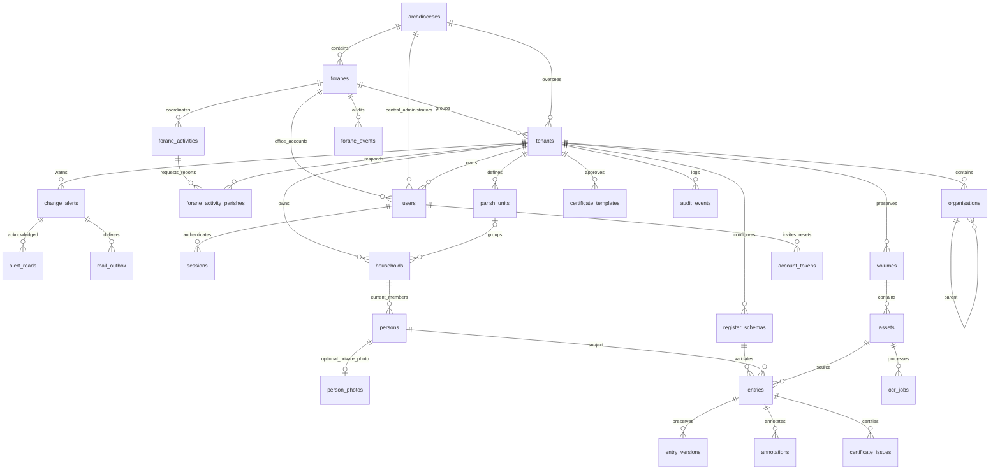

# Database ERD

All record-to-record tenant foreign keys include tenant_id. Actor foreign keys reference globally unique users, allowing central administrators to remain accountable in parish audit/history. RLS is forced on tenant tables. sessions and account tokens are accessed only by identity services. Version and audit rows cannot be updated or deleted by the application role.
